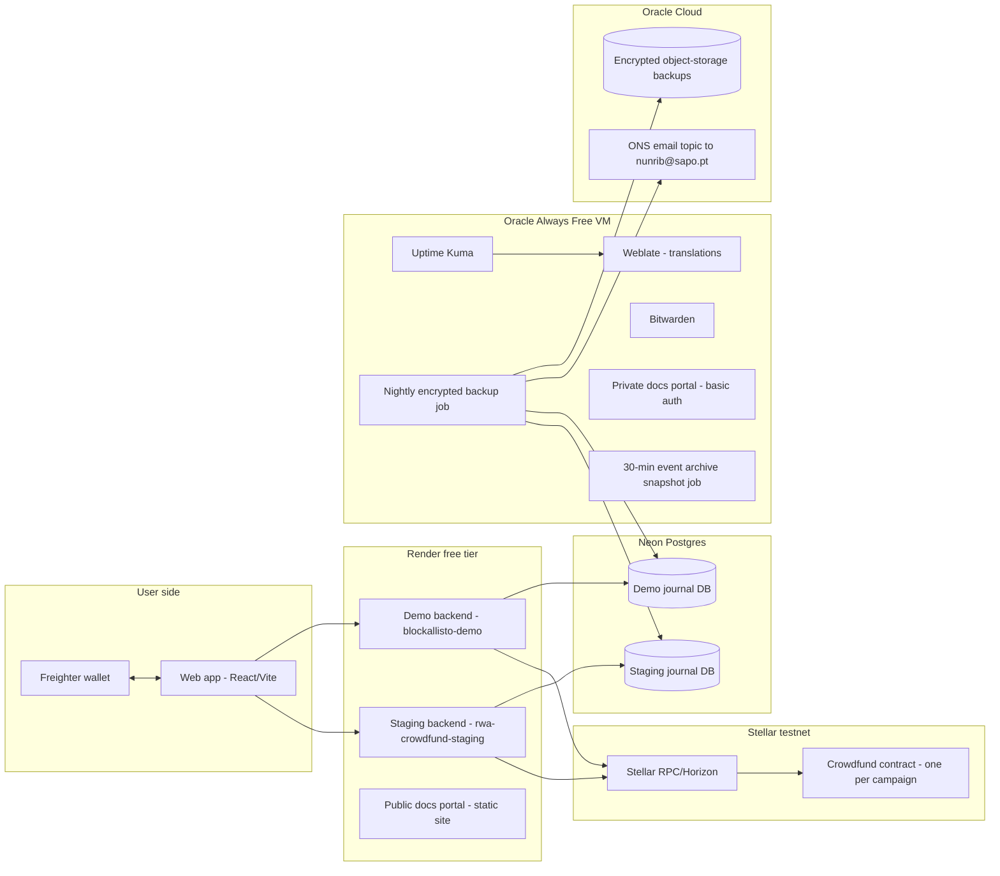
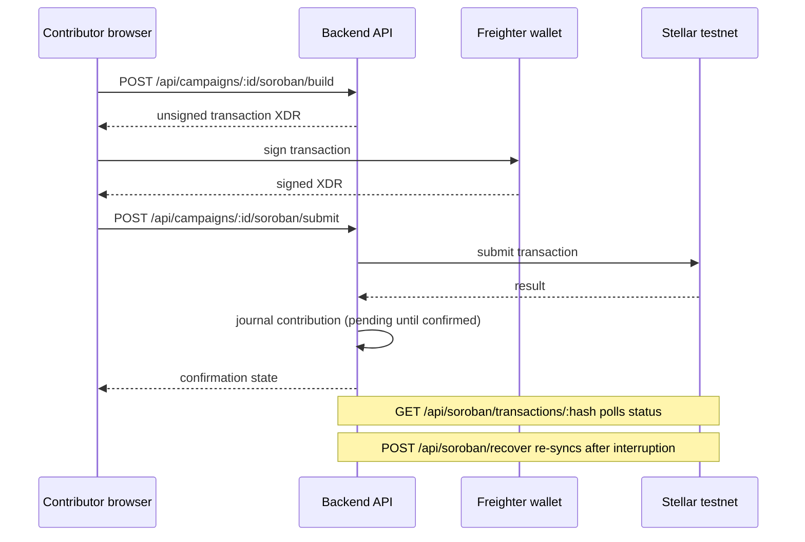
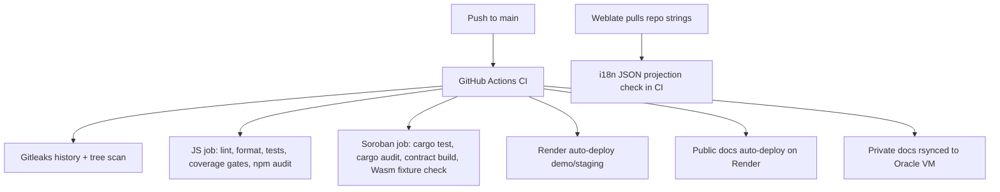

# Architecture and data-flow diagrams

These diagrams render with the Mermaid theme (see the portal config change in
this package). They are text, so they diff in pull requests instead of rotting
in a drawing tool. Sources of truth: backend/src, contracts/crowdfund, and the
observed hosting inventory (2 Nov 2026).

## Component map

## Contribution flow: prepare, sign, submit

## Translations, CI and deploy pipeline

